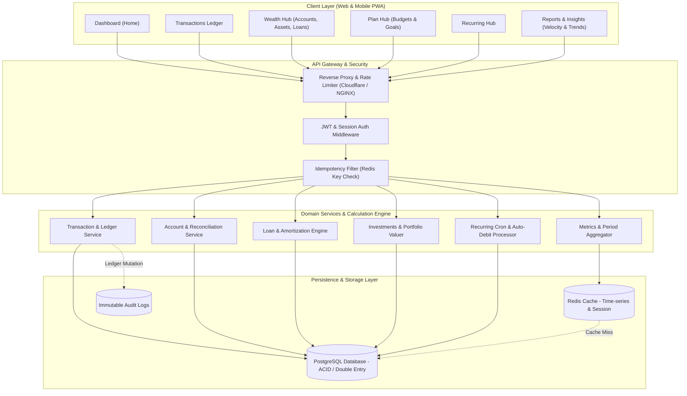
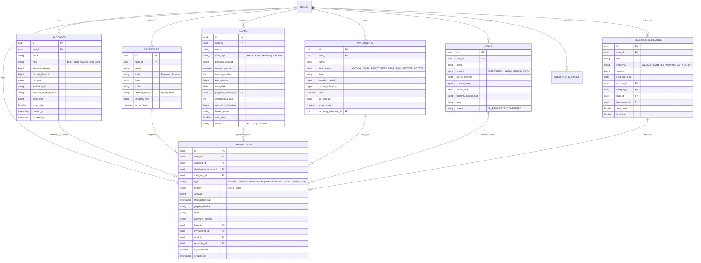

# WealthTrack End-to-End Backend API Architecture & Cross-Screen Correlation Specification

## Executive Summary

This specification defines the production-ready **Backend API Architecture, Database Schema, and Page-by-Page Data Correlation Engine** for **WealthTrack** (`daily-finance-garden`). It provides complete mathematical formulas, schema definitions, API contracts, atomic accounting invariants, and data-flow mappings linking every frontend UI component to its backend query.

---

## 1. System Architecture & Core Accounting Invariants

### 1.1 Architecture Topology



### 1.2 Core Financial Invariants (Zero-Error Invariants)

1. **Integer Minor Unit Currency Representation**: All monetary values are stored in the database as 64-bit integers representing **minor units** (e.g. Paise for INR, Cents for USD: ₹1,00,150.00 is stored as `10015000`). This eliminates IEEE 754 floating-point inaccuracies.
2. **Double-Entry Reconciliation**: Every financial transfer involves an exact credit and debit pairing:
   $$\Delta \text{Balance}(\text{SourceAccount}) + \Delta \text{Balance}(\text{TargetAccount}) = 0$$
3. **Deterministic Net Worth Identity**:
   $$\text{NetWorth} = \text{TotalAssets} - \text{TotalDebt}$$
   Where:
   - $\text{TotalAssets} = \text{LiquidCash} + \text{InvestmentsValuation} + \text{Receivables (Money Lent)}$
   - $\text{TotalDebt} = \text{LoansOutstanding} + \text{CreditCardDues}$
4. **Savings & Cash Flow Conservation Rule**:
   $$\text{Saved} = \text{MoneyIn} - \text{MoneyOut}$$
   $$\text{Saved} = \Delta \text{LiquidCash} + \text{NetInvested} + \text{NetLent} + \text{PrepaidDebt} - \text{NetBorrowed}$$
5. **50/30/20 Split Completeness (Largest Remainder Rounding)**:
   $$\text{Needs}\% + \text{Wants}\% + \text{Savings}\% = 100\% \quad (\text{when } \text{MoneyIn} > 0)$$

---

## 2. Database Schema & Entity Relationships

### 2.1 Entity Relationship Diagram



---

## 3. Comprehensive Page-by-Page Value Correlation Matrix

This section maps every UI block and metric to its backend computation and database inputs.

### 3.1 Dashboard (Home Screen)

| UI Component | Displayed Value / Metric | Backend Source & Derivation Formula | API Endpoint |
| :--- | :--- | :--- | :--- |
| **Hero Available Cash** | `₹8,08,120` | $\sum \text{current\_balance}$ for accounts where $\text{type} \in \{\text{"bank"}, \text{"cash"}, \text{"wallet"}\}$ and $\text{is\_archived} = \text{false}$ | `GET /api/v1/dashboard/summary` |
| **Total Assets Chip** | `₹13,00,620` | $\text{LiquidCash} + \sum \text{current\_valuation} (\text{Investments}) + \sum \text{Receivables}$ | `GET /api/v1/dashboard/summary` |
| **Free to Spend Chip** | `₹2,78,120` | $\text{LiquidCash} - \sum \text{current\_saved} (\text{Goals})$ | `GET /api/v1/dashboard/summary` |
| **Earmarked for Goals**| `₹5,30,000` | $\sum \text{current\_saved} (\text{Goals})$ | `GET /api/v1/dashboard/summary` |
| **Goals Coverage Status**| `Goals fully covered` | $\text{LiquidCash} \ge \text{EarmarkedCash} \implies \text{covered}$, else shows shortfall | `GET /api/v1/dashboard/summary` |
| **Total Loans Chip** | `Loans: ₹32,05,940` | $\sum \text{current\_outstanding} (\text{Active Loans}) + \sum \text{CreditCardDues}$ | `GET /api/v1/dashboard/summary` |
| **Money In Tile** | `+₹1,00,150` | $\sum \text{amount}$ for period where $\text{type} \in \{\text{"Income"}, \text{"Refund"}\}$ | `GET /api/v1/dashboard/summary` |
| **Money Out Tile** | `₹77,892` | $\sum \text{amount}$ for period where $\text{type} \in \{\text{"Expense"}, \text{"EMI / Loan Payment"}\}$ | `GET /api/v1/dashboard/summary` |
| **Saved Tile** | `₹22,258 (22%)` | $\text{Saved} = \text{MoneyIn} - \text{MoneyOut}$; $\text{Rate} = (\text{Saved} / \text{MoneyIn}) \times 100$ | `GET /api/v1/dashboard/summary` |
| **50/30/20 Progress Bar**| `Needs 71%, Wants 7%, Savings 22%` | Needs Spend ($\text{priority}=\text{"Need"} \lor \text{EMI}$), Wants ($\text{priority}=\text{"Want"}$), Net Surplus $\implies$ Largest Remainder Rounding | `GET /api/v1/dashboard/summary` |
| **Cash Runway Vital** | `20.4 months` | $\text{LiquidCash} / \text{AverageMonthlyLivingExpenses (Last 6 Months)}$ | `GET /api/v1/dashboard/summary` |
| **Emergency Cover Vital**| `3.1 months` | $\sum \text{current\_saved}(\text{Emergency Fund Goals}) / \text{MonthlyEssentialNeeds}$ | `GET /api/v1/dashboard/summary` |
| **EMI Load Vital** | `45%` | $(\sum \text{monthly\_emi} / \text{MoneyIn}) \times 100$ | `GET /api/v1/dashboard/summary` |
| **Budget Used Vital** | `70%` | $(\sum \text{ActualSpend}(\text{Categories}) / \sum \text{monthly\_limit}(\text{Categories})) \times 100$ | `GET /api/v1/dashboard/summary` |
| **Monthly EMIs & Debt**| `2 Active EMIs, ₹45,050/mo` | Filter `LOANS` where $\text{status}=\text{"ACTIVE"}$; derive installments left, auto-debit status | `GET /api/v1/dashboard/summary` |
| **Coming Up Section** | Upcoming recurring & EMIs | Query `RECURRING_SCHEDULES` joined with `LOANS` where $\text{next\_due\_date} \in [\text{today}, \text{end\_of\_month}]$ | `GET /api/v1/dashboard/summary` |
| **Goals & Sinking Funds**| 3 active goals progress | Query `GOALS` where $\text{status}=\text{"IN\_PROGRESS"}$; compute progress % & monthly allocation | `GET /api/v1/dashboard/summary` |
| **Top Spending** | Category limits & spend | Top 3 categories by monthly expenditure vs category `monthly_limit` | `GET /api/v1/dashboard/summary` |
| **Recent Activity** | Latest 4 transactions | `TRANSACTIONS` order by `transaction_date DESC LIMIT 4` | `GET /api/v1/dashboard/summary` |

---

### 3.2 Transactions Ledger Page

| UI Component | Functionality & Constraints | Backend Implementation | API Endpoint |
| :--- | :--- | :--- | :--- |
| **Filtered Activity Bar**| Inline status strip: count, Inflows ($+X$), Outflows ($-Y$), Net ($\pm Z$) | Aggregated SQL over current filter query predicates (`SUM(CASE WHEN...)`) | `GET /api/v1/transactions/summary` |
| **Paginated Data Table** | Virtualized / paginated rows with date, category icon, account badge, amount | Indexed dynamic SQL query with cursor or offset pagination (`page`, `pageSize`) | `GET /api/v1/transactions` |
| **Create Transaction** | Add Income, Expense, Transfer, EMI, Refund, Borrow, or Lend | ACID transaction verifying account balance (checks overdraft/insufficient balance) | `POST /api/v1/transactions` |
| **Edit Transaction** | Update amount, account, category, notes, or date | Reverse previous transaction ledger delta, then apply updated transaction delta | `PUT /api/v1/transactions/:id` |
| **Delete Transaction** | Remove entry | Reverse ledger delta from linked account balance and remove transaction record | `DELETE /api/v1/transactions/:id` |
| **Bulk Actions** | Bulk delete, bulk category change, bulk priority update | Atomic batch mutation within a single SQL transaction | `POST /api/v1/transactions/bulk` |
| **Bulk Import (CSV/XLSX)**| Staged ingestion with duplicate detection | Multi-row batch insert with checksum hash verification | `POST /api/v1/transactions/import` |

---

### 3.3 Wealth Hub (Accounts, Investments, Loans)

#### Accounts Subtab
- **Account Balances**: Live balance calculated from opening balance + posted journal line deltas.
- **Inter-Account Transfers**: Atomic transaction crediting destination account and debiting source account. Rejects if source account balance is insufficient (unless overdraft-enabled).
- **Reconciliation API**: Computes delta between user's real-world statement balance and current ledger balance. Generates an immutable reconciliation transaction type (`Adjustment`).

#### Investments Subtab
- **Holdings Summary**: Aggregate valuation, invested capital, total unrealized gain, and weighted return yield %.
- **SIP Integration**: Automated linking between an investment holding and a recurring monthly schedule.
- **Asset Allocation**: Percent distribution across Mutual Funds, Equity, Gold, Real Estate, and Cash.

#### Loans & Debt Subtab
- **Amortization Engine**: Computes exact principal vs. interest breakdown for each installment:
  $$\text{EMI} = P \times r \times \frac{(1+r)^n}{(1+r)^n - 1}$$
- **EMI Payment Trigger**: Debits the chosen bank account, logs transaction of type `EMI / Loan Payment`, reduces loan `current_outstanding` by the principal component, and advances paid count.
- **Debt Prepayment Calculator**: Evaluates interest savings and tenure reduction on lump-sum payments.
- **Money Lent & Advances (Receivables)**: Tracks peer-to-peer advances, partial recoveries, and outstanding balances.

---

### 3.4 Plan Hub (Budgets & Goals)

#### Budgets Subtab
- **Monthly Limit Tracking**: Compares posted expenses per category within the active calendar month against `monthly_limit`.
- **Rollover Budgets**: Optional carried-forward surplus or deficit from previous month.
- **Budget Health Score**: Percentage of categories operating within allocated limits.

#### Goals & Sinking Funds Subtab
- **Funding Progress**: $\text{Progress}\% = (\text{CurrentSaved} / \text{TargetAmount}) \times 100$.
- **Target Feasibility Calculator**: Determines if remaining months $\times$ `monthly_contribution` meets target amount by `target_date`.
- **Earmark Fund Protection**: Ensures that liquid bank balances never drop below total earmarked savings without triggering a liquidity warning.

---

### 3.5 Recurring Hub

- **Commitment Horizon**: Groups bills, EMIs, and SIPs by upcoming calendar date.
- **Auto-Debit Engine**: Background worker (cron) runs daily at 00:05 UTC. Finds active recurring items where $\text{auto\_debit} = \text{true}$ and $\text{next\_due\_date} \le \text{today}$. Automatically executes payment transaction and advances next occurrence.
- **Month-End Date Clamping**: Handles 28/29/30/31 day rollover safely (e.g. 31 Jan advances to 28 Feb, then 31 Mar).

---

### 3.6 Reports & Insights Page

- **Cash Flow Velocity Breakdown**: Day-by-day (monthly view) or month-by-month (yearly view) time-series providing synchronized arrays of `inflow`, `outflow`, and `netDelta`.
- **Cumulative Net Cash Flow Trend**: Running cumulative integral:
  $$\text{CumulativeNet}(t) = \sum_{k=1}^t (\text{Inflow}_k - \text{Outflow}_k)$$
- **50/30/20 Diagnostic Engine**: Classifies expenses into Needs, Wants, and Surplus Savings with Largest Remainder Rounding.
- **Where Your Savings Went Breakdown**: Reconciles operational surplus into asset buckets:
  $$\text{Saved} = \text{KeptInCash} + \text{InvestedNet} + \text{LentOutNet} + \text{PrepaidDebt} - \text{BorrowedNet}$$
- **Category Donut Aggregator**: Top 10 categories sorted by spend, with remaining categories grouped into `"Other Categories"`.

---

## 4. RESTful API Endpoint Specifications

All endpoints are prefixed with `/api/v1`. Authentication is handled via Bearer JWT in the `Authorization` header.

### 4.1 Dashboard Controller

#### `GET /api/v1/dashboard/summary`
Retrieves the consolidated cockpit payload for the specified month.
- **Query Parameters**:
  - `year` (int, default: current year)
  - `month` (int, 1-12, default: current month)
- **Response `200 OK`**:
```json
{
  "success": true,
  "data": {
    "period": { "year": 2026, "month": 10, "label": "Oct 2026" },
    "wealth": {
      "liquidCash": 80812000,
      "earmarkedCash": 53000000,
      "freeToSpend": 27812000,
      "investmentsValuation": 48250000,
      "receivablesTotal": 1000000,
      "totalAssets": 130062000,
      "totalDebt": 320594000,
      "netWorth": -190532000,
      "goalsFullyCovered": true
    },
    "periodMetrics": {
      "moneyIn": 10015000,
      "moneyOut": 7789200,
      "saved": 2225800,
      "savingsRatePct": 22,
      "needsSpend": 7133100,
      "wantsSpend": 656100,
      "split503020": { "needsPct": 71, "wantsPct": 7, "savingsPct": 22 },
      "vitals": {
        "cashRunwayMonths": 20.4,
        "emergencyCoverMonths": 3.1,
        "emiLoadPct": 45,
        "budgetUsedPct": 70
      }
    },
    "loansSummary": {
      "activeLoansCount": 2,
      "totalMonthlyEmi": 4505000,
      "totalOutstandingDebt": 323297000,
      "overallPayoffPct": 26,
      "loans": [
        {
          "id": "loan-01",
          "name": "Home Loan · Tower 4",
          "emi": 3085000,
          "outstanding": 281297000,
          "installmentsPaid": 29,
          "totalInstallments": 180,
          "autoDebit": true,
          "paymentAccountId": "acc-hdfc"
        }
      ]
    },
    "comingUp": [
      {
        "id": "rec-01",
        "title": "EV Car Loan (EMI)",
        "amount": 1420000,
        "dueDate": "2026-11-05",
        "daysRemaining": 10,
        "isEmi": true
      }
    ],
    "goals": [
      {
        "id": "goal-01",
        "name": "Emergency Reserve Fund (6-Mo)",
        "currentSaved": 12500000,
        "targetAmount": 18000000,
        "progressPct": 69,
        "monthlyContribution": 2000000
      }
    ],
    "recentTransactions": []
  }
}
```

---

### 4.2 Transactions Controller

#### `GET /api/v1/transactions`
Retrieves paginated, filtered transactions.
- **Query Parameters**:
  - `page` (int, default: 1)
  - `pageSize` (int, default: 15)
  - `startDate` (ISO date, e.g. `2026-10-01`)
  - `endDate` (ISO date, e.g. `2026-10-31`)
  - `accountIds` (comma-separated UUIDs)
  - `categoryIds` (comma-separated UUIDs)
  - `types` (comma-separated: `Income,Expense,Transfer,EMI`)
  - `priority` (`Need`, `Want`)
  - `search` (string)
  - `sort` (`newest | oldest | highest | lowest`)
- **Response `200 OK`**:
```json
{
  "success": true,
  "data": {
    "items": [
      {
        "id": "tx-101",
        "amount": 184200,
        "type": "Expense",
        "priority": "Need",
        "date": "2026-10-20T14:30:00Z",
        "accountId": "acc-hdfc",
        "accountName": "Everyday account",
        "categoryId": "cat-food",
        "categoryName": "Food & dining",
        "merchant": "Nature's Basket",
        "note": "Fresh groceries"
      }
    ],
    "pagination": {
      "currentPage": 1,
      "pageSize": 15,
      "totalRecords": 14,
      "totalPages": 1
    },
    "summary": {
      "totalInflows": 10015000,
      "totalOutflows": 7789200,
      "netTotal": 2225800
    }
  }
}
```

#### `POST /api/v1/transactions`
Creates a transaction with real-time balance validation and balance mutation.
- **Request Headers**:
  - `Idempotency-Key`: UUID (prevents duplicate submissions)
- **Request Body**:
```json
{
  "accountId": "acc-hdfc",
  "destinationAccountId": null,
  "categoryId": "cat-food",
  "type": "Expense",
  "priority": "Need",
  "amount": 184200,
  "date": "2026-10-20T14:30:00Z",
  "merchant": "Nature's Basket",
  "note": "Fresh groceries",
  "paymentMethod": "Debit Card"
}
```
- **Error Codes**:
  - `400 Bad Request`: Validation failure.
  - `422 Unprocessable Entity`: Insufficient account balance.
  - `409 Conflict`: Idempotency key collision.

---

### 4.3 Accounts & Transfers Controller

#### `POST /api/v1/accounts/transfer`
Executes an atomic transfer between two user accounts.
- **Request Body**:
```json
{
  "sourceAccountId": "acc-hdfc",
  "destinationAccountId": "acc-savings",
  "amount": 1500000,
  "date": "2026-10-22T10:00:00Z",
  "note": "Transfer to high-yield savings"
}
```

#### `POST /api/v1/accounts/:id/reconcile`
Balances an account to match bank statement reality.
- **Request Body**:
```json
{
  "statementBalance": 80812000,
  "statementDate": "2026-10-27",
  "notes": "Verified with October HDFC bank statement"
}
```

---

### 4.4 Loans & Debt Controller

#### `GET /api/v1/loans/:id/amortization`
Returns the complete mathematical amortization schedule for a loan.

#### `POST /api/v1/loans/:id/pay-emi`
Executes an EMI payment transaction.
- **Request Body**:
```json
{
  "accountId": "acc-hdfc",
  "paymentDate": "2026-10-10",
  "installmentNo": 30
}
```
- **Backend Execution Flow**:
  1. Validates that `acc-hdfc` has $\ge \text{EMI amount}$.
  2. Creates transaction of type `EMI / Loan Payment`.
  3. Computes exact split: Principal part $\rightarrow$ deducted from loan `current_outstanding`; Interest part $\rightarrow$ recorded as financing cost.
  4. Increments `installments_paid`.
  5. Updates associated recurring schedule `next_due_date` by $+1\text{ month}$.

---

### 4.5 Reports & Insights Controller

#### `GET /api/v1/reports/cash-flow-velocity`
Retrieves day-by-day continuous velocity curves for Recharts.
- **Query Parameters**:
  - `year` (int)
  - `month` (int)
- **Response `200 OK`**:
```json
{
  "success": true,
  "data": {
    "periodLabel": "October 2026",
    "days": [
      {
        "day": 1,
        "date": "2026-10-01",
        "shortLabel": "1",
        "fullDateLabel": "1 October 2026",
        "inflow": 0,
        "outflow": 1000000,
        "netDelta": -1000000
      },
      {
        "day": 19,
        "date": "2026-10-19",
        "shortLabel": "19",
        "fullDateLabel": "19 October 2026",
        "inflow": 8500000,
        "outflow": 0,
        "netDelta": 8500000
      }
    ],
    "totalInflow": 10015000,
    "totalOutflow": 7789200,
    "netMovement": 2225800
  }
}
```

#### `GET /api/v1/reports/cumulative-net-trend`
Retrieves the running cumulative cash flow accumulation points.

---

## 5. Non-Functional, Security & Performance Requirements

### 5.1 Idempotency & Concurrency Control
- All mutative financial operations (`POST /api/v1/transactions`, `POST /api/v1/loans/:id/pay-emi`, `POST /api/v1/accounts/transfer`) require an `Idempotency-Key` header.
- The server records the key in Redis with a 24-hour TTL and stores the returned response. Subsequent retries return the cached response without duplicate database execution.

### 5.2 Optimistic Locking on Account Balances
To prevent race conditions during concurrent transactions on the same account:
```sql
UPDATE accounts 
SET current_balance = current_balance - $amount, 
    version = version + 1
WHERE id = $accountId AND version = $expectedVersion;
```

### 5.3 Audit Trail & Ledger Immutability
- Financial transactions are never updated with a destructive `DELETE` in production. Deleted transactions are marked with `deleted_at` timestamps or reversed with counter-entries, guaranteeing 100% auditable accounting trails.

### 5.4 Performance SLAs
- `GET /api/v1/dashboard/summary`: $\le 80\text{ms}$ (via pre-aggregated Redis cache or single composite SQL index scan).
- `GET /api/v1/transactions`: $\le 50\text{ms}$ with composite index on `(user_id, transaction_date DESC, account_id)`.
