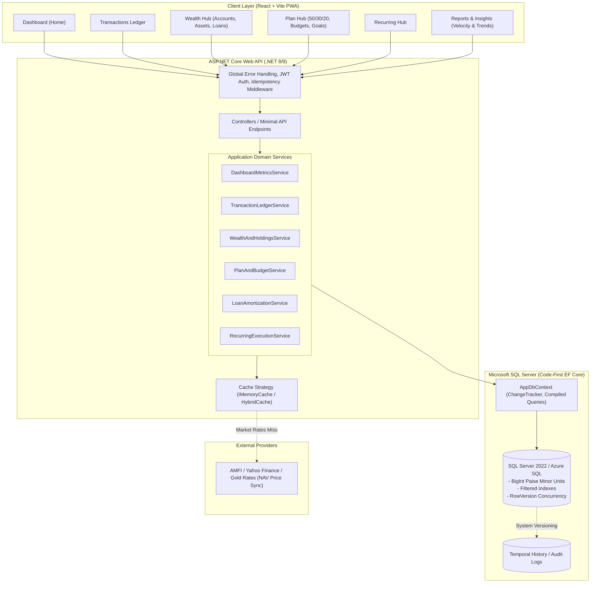

# WealthTrack Backend API Architecture & Database Specification (.NET Core & SQL Server)

## Executive Summary

This document defines the production-ready **Backend Architecture, Microsoft SQL Server Database Schema, Entity Framework Core Code-First Models, and Cross-Screen Correlation Engine** for **WealthTrack** (`daily-finance-garden`).

It has been tailored specifically for:
- **Runtime**: **.NET 8 / .NET 9 ASP.NET Core Web API**
- **Database Engine**: **Microsoft SQL Server (2022 / Azure SQL)**
- **ORM & Migrations**: **Entity Framework Core (EF Core) Code-First**
- **State & Invariants**: Integer minor-unit accounting (**Paise as `BIGINT`**), atomic ledger balancing, and strict UI-to-API correlation.

---

## 1. System Architecture & Caching Strategy

### 1.1 Architecture Topology



---

### 1.2 Do We Need Caching, and For What?

A common architectural trap in personal finance applications is **prematurely caching account balances, transaction ledgers, or dashboard totals**. In a financial ledger, **consistency and real-time accuracy are critical**. If a user enters an expense of ₹500 and returns to the dashboard to find their previous balance still displayed due to a 5-minute cache TTL or a missed cache-invalidation hook, user trust is destroyed.

#### 1.2.1 Why We Do NOT Cache User Balances or Transaction Queries
1. **Low Query Latency in SQL Server**: With clustered indexes on `(UserId, TransactionDate DESC)` and covering non-clustered indexes on account foreign keys, SQL Server executes a user's dashboard KPI calculation in **3 to 12 milliseconds** even with 50,000 transactions.
2. **Cache Invalidation Fragility**: Financial data is interdependent. Modifying a single transaction impacts:
   - Account Balance
   - Total Assets
   - Net Worth
   - Free to Spend
   - Monthly Money In / Money Out
   - 50/30/20 Needs/Wants/Savings ratio
   - Category budget spend
   - Cash runway metric
   
   Attempting to invalidate or patch all these keys across a distributed cache (like Redis) invites race conditions and cache desynchronization bugs.

#### 1.2.2 Where Caching IS Necessary & High-Value
In WealthTrack, caching is used strictly for three specific, safe domains:

| Cache Domain | Recommended Cache Mechanism | TTL (Time-to-Live) | Why Caching is Required |
| :--- | :--- | :--- | :--- |
| **External Market NAV & Asset Prices** | In-Memory (`IMemoryCache` / `HybridCache`) | 15 minutes – 4 hours (EOD for Mutual Funds) | Mutual fund NAVs (AMFI), stock tickers, and gold prices are fetched from external third-party APIs with strict rate limits. Caching avoids external latency and prevents API rate-limiting errors. |
| **Static Master Data & Lookups** | In-Memory (`IMemoryCache`) | 24 hours (or app lifetime) | System categories, supported banks/institutions, IFSC directory, currency definitions, and default emoji icon maps never change during normal operation. |
| **Idempotency Verification Tokens** | `IMemoryCache` (Single Instance) or Distributed Cache | 5 minutes | Prevents duplicate transaction submissions from client-side double clicks or unstable mobile networks. Stores the hash of `(UserId, IdempotencyKey)`. |

#### 1.2.3 Implementation Recommendation for .NET Core
- Start with **ASP.NET Core's built-in `IMemoryCache`** (or .NET 9's new `HybridCache`).
- **No extra Redis server is required** at the start. In-memory caching runs directly inside the .NET process with zero network overhead.
- If you later scale horizontally to multiple containerized API pods behind a load balancer, simply swap the backing store to `IDistributedCache` (SQL Server distributed cache or Redis) without changing domain code.

---

## 2. Core Financial Invariants & Mathematical Rules

1. **Integer Minor-Unit Currency (`BIGINT`)**:
   - All monetary figures are stored as 64-bit integers (`long` in C#, `BIGINT` in SQL Server) representing **paise** (e.g. ₹1,00,150.00 is stored as `10015000`).
   - Floats (`float`, `double`) are strictly prohibited for monetary arithmetic to prevent IEEE-754 precision loss.
2. **Atomic Double-Entry Transfers**:
   - Transfers between accounts execute inside an EF Core `IDbContextTransaction`:
     $$\Delta \text{Balance}(\text{SourceAccount}) + \Delta \text{Balance}(\text{DestinationAccount}) = 0$$
3. **Deterministic Net Worth Identity**:
   $$\text{NetWorth} = \text{TotalAssets} - \text{TotalDebt}$$
   - $\text{TotalAssets} = \text{LiquidCash} + \text{InvestmentsValuation} + \text{Receivables (Money Lent)}$
   - $\text{TotalDebt} = \text{LoansOutstanding} + \text{CreditCardDues}$
4. **Conservation of Cash Flow & Savings Deployment**:
   $$\text{Saved} = \text{MoneyIn} - \text{MoneyOut}$$
   $$\text{Saved} = \Delta \text{LiquidCash} + \text{NetInvested} + \text{NetLent} + \text{PrepaidDebt} - \text{NetBorrowed}$$
5. **50/30/20 Split Completeness (Largest Remainder Rounding)**:
   - When $\text{MoneyIn} > 0$, Needs %, Wants %, and Savings % are rounded using the Largest Remainder (Hamilton-Hare) method so that:
     $$\text{Needs}\% + \text{Wants}\% + \text{Savings}\% \equiv 100\%$$

---

## 3. EF Core Code-First Entity Models (C#)

Below are the complete domain entities configured for EF Core with SQL Server.

### 3.1 Domain Enums

```csharp
namespace WealthTrack.Domain.Enums;

public enum AccountType
{
    Bank = 1,
    Cash = 2,
    Wallet = 3,
    CreditCard = 4
}

public enum TransactionKind
{
    Income = 1,
    Expense = 2,
    Transfer = 3
}

public enum TransactionSubtype
{
    Standard = 0,
    Emi = 1,
    Sip = 2,
    LumpSum = 3,
    Lent = 4,
    Recovered = 5,
    Borrowed = 6,
    Repaid = 7,
    Prepayment = 8,
    Refund = 9,
    Redemption = 10
}

public enum NeedWantPriority
{
    Need = 1,
    Want = 2
}

public enum LoanType
{
    Home = 1,
    Auto = 2,
    Personal = 3,
    Education = 4,
    Gold = 5
}

public enum LoanStatus
{
    Active = 1,
    Closed = 2
}

public enum AssetClass
{
    MutualFund = 1,
    Equity = 2,
    Etf = 3,
    Gold = 4,
    RealEstate = 5,
    Crypto = 6,
    FixedDeposit = 7
}

public enum GoalPriority
{
    Emergency = 1,
    High = 2,
    Medium = 3,
    Low = 4
}

public enum GoalStatus
{
    InProgress = 1,
    Completed = 2,
    Archived = 3
}

public enum RecurringFrequency
{
    Weekly = 1,
    Monthly = 2,
    Quarterly = 3,
    Yearly = 4
}
```

---

### 3.2 Code-First Entity Classes

#### 1. Account Entity
```csharp
namespace WealthTrack.Domain.Entities;

public class Account
{
    public Guid Id { get; set; } = Guid.NewGuid();
    public Guid UserId { get; set; }
    public string Name { get; set; } = string.Empty;
    public AccountType Type { get; set; }
    
    // Amount in Paise (BIGINT)
    public long OpeningBalance { get; set; }
    public long CurrentBalance { get; set; }
    public long? CreditLimit { get; set; }
    
    public string Currency { get; set; } = "INR";
    public string? InstitutionId { get; set; }
    public string? AccountNumberMask { get; set; }
    public string? ColorHex { get; set; }
    public bool IsArchived { get; set; }
    
    public DateTimeOffset CreatedAt { get; set; } = DateTimeOffset.UtcNow;
    public DateTimeOffset UpdatedAt { get; set; } = DateTimeOffset.UtcNow;

    // Optimistic Concurrency Token for SQL Server
    public byte[] RowVersion { get; set; } = [];

    // Navigation Properties
    public ICollection<Transaction> SourceTransactions { get; set; } = new List<Transaction>();
    public ICollection<Transaction> DestinationTransactions { get; set; } = new List<Transaction>();
    public ICollection<Loan> LinkedLoans { get; set; } = new List<Loan>();
    public ICollection<RecurringSchedule> LinkedSchedules { get; set; } = new List<RecurringSchedule>();
}
```

#### 2. Category Entity
```csharp
namespace WealthTrack.Domain.Entities;

public class Category
{
    public Guid Id { get; set; } = Guid.NewGuid();
    public Guid? UserId { get; set; } // Null = System Default Category
    public string Name { get; set; } = string.Empty;
    public TransactionKind Kind { get; set; }
    public string Icon { get; set; } = string.Empty;
    public string ColorHex { get; set; } = string.Empty;
    public NeedWantPriority DefaultPriority { get; set; } = NeedWantPriority.Need;
    
    // Monthly budget limit in Paise
    public long? MonthlyLimit { get; set; }
    public bool IsArchived { get; set; }

    public ICollection<Transaction> Transactions { get; set; } = new List<Transaction>();
}
```

#### 3. Transaction Entity
```csharp
namespace WealthTrack.Domain.Entities;

public class Transaction
{
    public Guid Id { get; set; } = Guid.NewGuid();
    public Guid UserId { get; set; }
    
    public Guid AccountId { get; set; }
    public Account Account { get; set; } = null!;
    
    public Guid? DestinationAccountId { get; set; }
    public Account? DestinationAccount { get; set; }
    
    public Guid? CategoryId { get; set; }
    public Category? Category { get; set; }
    
    public TransactionKind Kind { get; set; }
    public TransactionSubtype Subtype { get; set; } = TransactionSubtype.Standard;
    public NeedWantPriority? Priority { get; set; }
    
    // Amount in Paise (BIGINT). Always positive; direction governed by Kind and Subtype.
    public long Amount { get; set; }
    
    public DateTimeOffset TransactionDate { get; set; }
    public string? PayeeMerchant { get; set; }
    public string? Note { get; set; }
    public string? PaymentMethod { get; set; }
    public string? ReceiptAttachmentPath { get; set; }
    
    // Linked Entity Foreign Keys
    public Guid? LoanId { get; set; }
    public Loan? Loan { get; set; }

    public Guid? InvestmentId { get; set; }
    public Investment? Investment { get; set; }

    public Guid? GoalId { get; set; }
    public Goal? Goal { get; set; }

    public Guid? RecurringScheduleId { get; set; }
    public RecurringSchedule? RecurringSchedule { get; set; }

    public bool IsReconciled { get; set; }
    public bool IsDeleted { get; set; } // Soft-delete for audit trail

    public DateTimeOffset CreatedAt { get; set; } = DateTimeOffset.UtcNow;
    public DateTimeOffset? UpdatedAt { get; set; }
}
```

#### 4. Loan Entity
```csharp
namespace WealthTrack.Domain.Entities;

public class Loan
{
    public Guid Id { get; set; } = Guid.NewGuid();
    public Guid UserId { get; set; }
    public string Name { get; set; } = string.Empty;
    public LoanType Type { get; set; }
    public string LenderName { get; set; } = string.Empty;
    
    public long PrincipalAmount { get; set; } // Paise
    public decimal AnnualInterestRatePct { get; set; } // e.g. 8.5000 %
    public int TenureMonths { get; set; }
    public long MonthlyEmiAmount { get; set; } // Paise
    public long CurrentOutstanding { get; set; } // Paise
    public int InstallmentsPaid { get; set; }
    
    public DateOnly StartDate { get; set; }
    public int DueDayOfMonth { get; set; }
    public bool AutoDebit { get; set; }
    public LoanStatus Status { get; set; } = LoanStatus.Active;
    
    public Guid? PaymentAccountId { get; set; }
    public Account? PaymentAccount { get; set; }

    public ICollection<Transaction> Transactions { get; set; } = new List<Transaction>();
}
```

#### 5. Investment Holding Entity
```csharp
namespace WealthTrack.Domain.Entities;

public class Investment
{
    public Guid Id { get; set; } = Guid.NewGuid();
    public Guid UserId { get; set; }
    public string Name { get; set; } = string.Empty;
    public AssetClass AssetClass { get; set; }
    public string? TickerOrSymbol { get; set; }
    public string? FolioNumber { get; set; }
    
    public long InvestedCapital { get; set; } // Paise
    public long CurrentValuation { get; set; } // Paise
    public decimal UnitsHeld { get; set; } // e.g. 154.2384
    public decimal? LatestNavPrice { get; set; } // Current NAV / Stock price
    public DateTimeOffset? NavLastUpdatedAt { get; set; }
    
    public long? SipAmount { get; set; } // Paise
    public bool IsRecurringSip { get; set; }
    public Guid? RecurringScheduleId { get; set; }

    public ICollection<Transaction> Transactions { get; set; } = new List<Transaction>();
}
```

#### 6. Goal Entity
```csharp
namespace WealthTrack.Domain.Entities;

public class Goal
{
    public Guid Id { get; set; } = Guid.NewGuid();
    public Guid UserId { get; set; }
    public string Name { get; set; } = string.Empty;
    public GoalPriority Priority { get; set; }
    public GoalStatus Status { get; set; } = GoalStatus.InProgress;
    
    public long TargetAmount { get; set; } // Paise
    public long CurrentSaved { get; set; } // Paise (Earmarked cash)
    public DateOnly TargetDate { get; set; }
    public long MonthlyContribution { get; set; } // Paise
    
    public string? Icon { get; set; }
    public string? ColorHex { get; set; }

    public ICollection<Transaction> Transactions { get; set; } = new List<Transaction>();
}
```

#### 7. Recurring Schedule Entity
```csharp
namespace WealthTrack.Domain.Entities;

public class RecurringSchedule
{
    public Guid Id { get; set; } = Guid.NewGuid();
    public Guid UserId { get; set; }
    public string Title { get; set; } = string.Empty;
    public RecurringFrequency Frequency { get; set; }
    
    public long Amount { get; set; } // Paise
    public DateOnly NextDueDate { get; set; }
    public bool AutoDebit { get; set; }
    public bool IsActive { get; set; } = true;
    
    public Guid AccountId { get; set; }
    public Account Account { get; set; } = null!;
    
    public Guid? CategoryId { get; set; }
    public Category? Category { get; set; }
    
    public Guid? LoanId { get; set; }
    public Loan? Loan { get; set; }

    public Guid? InvestmentId { get; set; }
    public Investment? Investment { get; set; }
}
```

---

### 3.3 EF Core `DbContext` & Fluent API Configurations

```csharp
namespace WealthTrack.Infrastructure.Data;

using Microsoft.EntityFrameworkCore;
using WealthTrack.Domain.Entities;

public class AppDbContext : DbContext
{
    public AppDbContext(DbContextOptions<AppDbContext> options) : base(options) { }

    public DbSet<Account> Accounts => Set<Account>();
    public DbSet<Category> Categories => Set<Category>();
    public DbSet<Transaction> Transactions => Set<Transaction>();
    public DbSet<Loan> Loans => Set<Loan>();
    public DbSet<Investment> Investments => Set<Investment>();
    public DbSet<Goal> Goals => Set<Goal>();
    public DbSet<RecurringSchedule> RecurringSchedules => Set<RecurringSchedule>();

    protected override void OnModelCreating(ModelBuilder modelBuilder)
    {
        base.OnModelCreating(modelBuilder);

        // 1. Account Configuration
        modelBuilder.Entity<Account>(b =>
        {
            b.HasKey(a => a.Id);
            b.Property(a => a.Name).HasMaxLength(100).IsRequired();
            b.Property(a => a.Currency).HasMaxLength(10).HasDefaultValue("INR");
            b.Property(a => a.OpeningBalance).IsRequired();
            b.Property(a => a.CurrentBalance).IsRequired();
            
            // SQL Server RowVersion for optimistic concurrency protection
            b.Property(a => a.RowVersion).IsRowVersion();

            // Filtered index for active accounts
            b.HasIndex(a => new { a.UserId, a.IsArchived });
        });

        // 2. Transaction Configuration
        modelBuilder.Entity<Transaction>(b =>
        {
            b.HasKey(t => t.Id);
            b.Property(t => t.Amount).IsRequired();
            b.Property(t => t.PayeeMerchant).HasMaxLength(150);
            b.Property(t => t.Note).HasMaxLength(500);
            b.Property(t => t.PaymentMethod).HasMaxLength(50);

            // Source Account Relationship
            b.HasOne(t => t.Account)
                .WithMany(a => a.SourceTransactions)
                .HasForeignKey(t => t.AccountId)
                .OnDelete(DeleteBehavior.Restrict);

            // Destination Account Relationship (for Transfers)
            b.HasOne(t => t.DestinationAccount)
                .WithMany(a => a.DestinationTransactions)
                .HasForeignKey(t => t.DestinationAccountId)
                .OnDelete(DeleteBehavior.Restrict);

            // Category Relationship
            b.HasOne(t => t.Category)
                .WithMany(c => c.Transactions)
                .HasForeignKey(t => t.CategoryId)
                .OnDelete(DeleteBehavior.SetNull);

            // High-performance Composite Clustered Index for user ledger queries
            b.HasIndex(t => new { t.UserId, t.TransactionDate, t.IsDeleted })
                .IncludeProperties(t => new { t.Amount, t.Kind, t.Subtype, t.AccountId, t.CategoryId });

            // Global Query Filter for Soft Delete
            b.HasQueryFilter(t => !t.IsDeleted);
        });

        // 3. Loan Configuration
        modelBuilder.Entity<Loan>(b =>
        {
            b.HasKey(l => l.Id);
            b.Property(l => l.Name).HasMaxLength(120).IsRequired();
            b.Property(l => l.LenderName).HasMaxLength(120).IsRequired();
            b.Property(l => l.AnnualInterestRatePct).HasPrecision(6, 4); // e.g. 12.3500 %
            b.Property(l => l.PrincipalAmount).IsRequired();
            b.Property(l => l.MonthlyEmiAmount).IsRequired();
            b.Property(l => l.CurrentOutstanding).IsRequired();

            b.HasOne(l => l.PaymentAccount)
                .WithMany(a => a.LinkedLoans)
                .HasForeignKey(l => l.PaymentAccountId)
                .OnDelete(DeleteBehavior.SetNull);

            b.HasIndex(l => new { l.UserId, l.Status });
        });

        // 4. Investment Configuration
        modelBuilder.Entity<Investment>(b =>
        {
            b.HasKey(i => i.Id);
            b.Property(i => i.Name).HasMaxLength(120).IsRequired();
            b.Property(i => i.TickerOrSymbol).HasMaxLength(50);
            b.Property(i => i.UnitsHeld).HasPrecision(18, 4);
            b.Property(i => i.LatestNavPrice).HasPrecision(18, 4);

            b.HasIndex(i => new { i.UserId, i.AssetClass });
        });

        // 5. Goal Configuration
        modelBuilder.Entity<Goal>(b =>
        {
            b.HasKey(g => g.Id);
            b.Property(g => g.Name).HasMaxLength(120).IsRequired();
            b.HasIndex(g => new { g.UserId, g.Status });
        });

        // 6. Recurring Schedule Configuration
        modelBuilder.Entity<RecurringSchedule>(b =>
        {
            b.HasKey(r => r.Id);
            b.Property(r => r.Title).HasMaxLength(120).IsRequired();

            b.HasOne(r => r.Account)
                .WithMany(a => a.LinkedSchedules)
                .HasForeignKey(r => r.AccountId)
                .OnDelete(DeleteBehavior.Restrict);

            b.HasIndex(r => new { r.UserId, r.IsActive, r.NextDueDate });
        });
    }
}
```

---

## 4. Cross-Screen Data Correlation Matrix

This matrix establishes 1:1 mathematical fidelity between the frontend UI views and the backend services.

### 4.1 Dashboard (`/dashboard`)

| Frontend UI Component | Display Value | Backend Calculation & SQL Query | .NET Core Service Method |
| :--- | :--- | :--- | :--- |
| **Hero Available Cash** | `₹8,08,120` | `SUM(CurrentBalance)` where `Type IN (Bank, Cash, Wallet)` and `!IsArchived` | `_wealthService.GetAvailableCashAsync(userId)` |
| **Total Assets Chip** | `₹13,00,620` | $\text{LiquidCash} + \sum \text{CurrentValuation} + \sum \text{Receivables}$ | `_wealthService.GetWealthMetricsAsync(userId)` |
| **Free to Spend Chip** | `₹2,78,120` | $\text{LiquidCash} - \sum \text{CurrentSaved}(\text{Goals})$ | `_wealthService.GetWealthMetricsAsync(userId)` |
| **Earmarked for Goals** | `₹5,30,000` | $\sum \text{CurrentSaved}(\text{Goals where Status == InProgress})$ | `_goalService.GetTotalEarmarkedAsync(userId)` |
| **Goals Coverage Status** | `Goals fully covered` | `LiquidCash >= EarmarkedCash ? "covered" : "shortfall"` | `_dashboardService.GetSummaryAsync(userId)` |
| **Total Loans Chip** | `Loans: ₹32,05,940` | $\sum \text{CurrentOutstanding}(\text{Active Loans}) + \sum |\min(0, \text{Balance}(\text{CreditCard}))|$ | `_loanService.GetTotalDebtAsync(userId)` |
| **Money In Tile** | `+₹1,00,150` | `SUM(Amount)` where `Kind == Income` within selected month | `_metricsService.GetPeriodCashFlowAsync(userId, period)` |
| **Money Out Tile** | `₹77,892` | `SUM(Amount)` where `Kind == Expense` (or `Subtype == Emi`) within month | `_metricsService.GetPeriodCashFlowAsync(userId, period)` |
| **Saved Tile** | `₹22,258 (22%)` | $\text{Saved} = \text{MoneyIn} - \text{MoneyOut}$; $\text{Rate} = (\text{Saved} / \text{MoneyIn}) \times 100$ | `_metricsService.GetPeriodCashFlowAsync(userId, period)` |
| **50/30/20 Breakdown** | `Needs 71%, Wants 7%, Savings 22%` | Needs: $\sum (\text{Priority} == \text{Need} \lor \text{Emi})$; Wants: $\sum (\text{Priority} == \text{Want})$; Savings: $\max(0, \text{Saved})$. Evaluated via Hamilton-Hare Largest Remainder rounding. | `_planService.Get503020SplitAsync(userId, period)` |
| **Cash Runway Vital** | `20.4 months` | $\text{LiquidCash} / \text{AverageMonthlyLivingExpenses (Last 6 Months)}$ | `_dashboardService.GetFinancialVitalsAsync(userId)` |
| **Emergency Cover Vital**| `3.1 months` | $\sum \text{CurrentSaved}(\text{Emergency Goals}) / \text{MonthlyEssentialNeeds}$ | `_dashboardService.GetFinancialVitalsAsync(userId)` |
| **EMI Load Vital** | `45%` | $(\sum \text{MonthlyEmi} / \text{MoneyIn}) \times 100$ | `_dashboardService.GetFinancialVitalsAsync(userId)` |
| **Budget Used Vital** | `70%` | $(\sum \text{ActualSpend}(\text{Categories}) / \sum \text{MonthlyLimit}(\text{Categories})) \times 100$ | `_dashboardService.GetFinancialVitalsAsync(userId)` |
| **Monthly EMIs & Debt** | `2 Active EMIs, ₹45,050/mo` | Query `Loans` where `Status == Active` | `_loanService.GetActiveEmisAsync(userId)` |
| **Coming Up Section** | Upcoming recurring payments | Query `RecurringSchedules` where `NextDueDate <= EndOfMonth` | `_recurringService.GetUpcomingDuesAsync(userId)` |
| **Top Spending** | Category limits & spend | Top 3 categories grouped by spend vs category limit | `_metricsService.GetTopSpendingCategoriesAsync(userId)` |

---

### 4.2 Transactions Ledger (`/transactions`)

| Frontend UI Component | Backend SQL Execution | .NET Core Service |
| :--- | :--- | :--- |
| **Filtered Activity Bar** | Aggregated `COUNT(*)`, `SUM(Inflows)`, `SUM(Outflows)`, `SUM(Net)` computed directly in a single SQL query matching the applied filter parameters. | `_txService.GetSummaryAsync(filter)` |
| **Paginated Ledger Table** | `IQueryable<Transaction>` with `.Where(filter).OrderByDescending(t => t.TransactionDate).Skip(page * size).Take(size)`. | `_txService.GetPagedListAsync(filter)` |
| **Create Transaction** | Atomic balance mutation within `await using var tx = await _db.Database.BeginTransactionAsync()`: updates source account `CurrentBalance` and posts transaction entry. | `_txService.CreateTransactionAsync(dto)` |
| **Update Transaction** | Reverses previous transaction amount from account, updates fields, applies new amount to account balance inside a transaction. | `_txService.UpdateTransactionAsync(id, dto)` |
| **Delete Transaction** | Soft deletes (`IsDeleted = true`), restores account balance. | `_txService.DeleteTransactionAsync(id)` |

---

### 4.3 Wealth Hub (`/wealth`)

| Frontend UI Component | Derivation Formula | .NET Core Service |
| :--- | :--- | :--- |
| **Accounts List** | Read `Accounts` with balances and institution badges | `_wealthService.GetAccountsAsync(userId)` |
| **Investments Portfolio** | Read `Investments`; calculate `Gain = CurrentValuation - InvestedCapital`, `GainPct = (Gain / Invested) * 100` | `_wealthService.GetInvestmentsAsync(userId)` |
| **Loans & Liabilities** | Read `Loans`; calculate `PaidPct = (InstallmentsPaid / TenureMonths) * 100` | `_loanService.GetLoansAsync(userId)` |
| **Net Wealth Trend Chart** | Month-by-month historical asset values minus liabilities | `_reportsService.GetNetWealthTrendAsync(userId, range)` |

---

### 4.4 Plan Hub (`/plan`)

| Frontend UI Component | Derivation Formula | .NET Core Service |
| :--- | :--- | :--- |
| **50/30/20 Target vs Actual** | Target: $50\%$ Needs, $30\%$ Wants, $20\%$ Savings. Actual: dynamically mapped using Largest Remainder Rounding. | `_planService.GetPlanOverviewAsync(userId, month)` |
| **Category Budget Progress** | Compare monthly expense per category against `MonthlyLimit` | `_planService.GetCategoryBudgetsAsync(userId, month)` |
| **Goals & Sinking Funds** | Computes projected target completion date: `MonthsRemaining = (TargetAmount - CurrentSaved) / MonthlyContribution` | `_goalService.GetGoalsAsync(userId)` |

---

### 4.5 Reports & Insights (`/reports`, `/insights`)

| Frontend UI Component | Backend Derivation & Recharts Compatibility | .NET Core Service |
| :--- | :--- | :--- |
| **Cash Flow Velocity Chart** | Day-by-day continuous array for Recharts: `{ day, date, inflow, outflow, netDelta }` | `_reportsService.GetCashFlowVelocityAsync(userId, year, month)` |
| **Cumulative Net Trend** | Daily running accumulation sum of $(Inflow - Outflow)$ | `_reportsService.GetCumulativeNetTrendAsync(userId, year, month)` |
| **Category Spend Pie Chart** | Category breakdown grouped by percentage of total spend | `_reportsService.GetCategoryDistributionAsync(userId, period)` |
| **Where Your Savings Went** | Identity: $\text{KeptInCash} + \text{NetInvested} + \text{NetLent} + \text{PrepaidDebt} - \text{NetBorrowed} \equiv \text{Saved}$ | `_reportsService.GetSavingsDeploymentAsync(userId, period)` |

---

## 5. .NET Core Web API Endpoints Contract

All endpoints follow RESTful conventions and return responses wrapped in a standard `ApiResponse<T>`:

```csharp
public record ApiResponse<T>(bool Success, T? Data, string? ErrorMessage = null);
```

### 5.1 Dashboard Controller (`/api/v1/dashboard`)
- `GET /api/v1/dashboard/summary?period=2026-10`
  - Returns: All hero metrics, available cash, 50/30/20 split, vitals, upcoming dues, active EMIs, and recent activity in a single payload.

### 5.2 Transactions Controller (`/api/v1/transactions`)
- `GET /api/v1/transactions?period=2026-10&accountId={guid}&categoryId={guid}&kind={kind}&search={q}&page=1&pageSize=50`
- `GET /api/v1/transactions/summary?period=2026-10`
- `POST /api/v1/transactions` (Requires `Idempotency-Key` header)
- `PUT /api/v1/transactions/{id}`
- `DELETE /api/v1/transactions/{id}`
- `POST /api/v1/transactions/bulk-delete`
- `POST /api/v1/transactions/bulk-categorize`

### 5.3 Accounts Controller (`/api/v1/accounts`)
- `GET /api/v1/accounts`
- `POST /api/v1/accounts`
- `PUT /api/v1/accounts/{id}`
- `POST /api/v1/accounts/transfer` (Atomic double-entry transfer)
- `POST /api/v1/accounts/{id}/archive`

### 5.4 Loans Controller (`/api/v1/loans`)
- `GET /api/v1/loans`
- `POST /api/v1/loans`
- `GET /api/v1/loans/{id}/amortization` (Generates full month-by-month schedule)
- `POST /api/v1/loans/{id}/pay-emi` (Executes EMI payment and updates balance/tenure)
- `POST /api/v1/loans/{id}/prepayment` (Reduces principal balance directly)

### 5.5 Investments & Wealth Controller (`/api/v1/wealth`)
- `GET /api/v1/wealth/summary`
- `GET /api/v1/wealth/holdings`
- `POST /api/v1/wealth/holdings`
- `POST /api/v1/wealth/holdings/{id}/sync-nav` (Fetches latest NAV price, cached in memory)

### 5.6 Plan & Budgets Controller (`/api/v1/plan`)
- `GET /api/v1/plan/overview?period=2026-10`
- `PUT /api/v1/plan/categories/{id}/budget`
- `GET /api/v1/plan/goals`
- `POST /api/v1/plan/goals`
- `POST /api/v1/plan/goals/{id}/contribute` (Earmarks liquid cash to goal)

### 5.7 Reports Controller (`/api/v1/reports`)
- `GET /api/v1/reports/cash-flow-velocity?year=2026&month=10`
- `GET /api/v1/reports/net-wealth-trend?range=1Y`
- `GET /api/v1/reports/savings-deployment?period=2026-10`

---

## 6. Migration & Database Deployment Commands

Using EF Core CLI tools with SQL Server:

```powershell
# 1. Install required EF Core packages
dotnet add package Microsoft.EntityFrameworkCore.SqlServer
dotnet add package Microsoft.EntityFrameworkCore.Design

# 2. Add initial code-first migration
dotnet ef migrations add InitialWealthTrackDb --output-dir Data/Migrations

# 3. Apply migration to local/dev SQL Server
dotnet ef database update

# 4. Generate idempotent SQL script for CI/CD Azure pipeline deployment
dotnet ef migrations script --idempotent --output ./deploy/migration.sql
```
