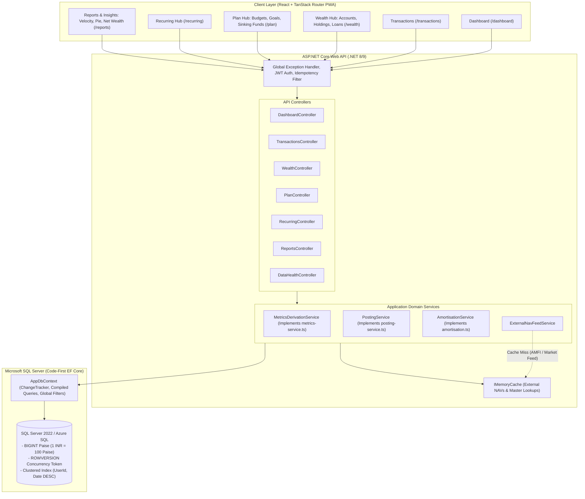

# WealthTrack Backend API Architecture & Database Specification (.NET Core & SQL Server)

## Executive Summary

This specification defines the production-ready **Backend Architecture, Microsoft SQL Server Database Schema, Entity Framework Core (EF Core) Code-First Domain Models, and Cross-Screen Correlation Engine** for **WealthTrack** (`daily-finance-garden`).

Following a deep code-level audit of the frontend domain layer (`src/lib/domain-model.ts`, `src/lib/metrics-service.ts`, `src/lib/posting-service.ts`, `src/lib/amortisation.ts`, and Vitest test suites `integrity.test.ts` & `cross-screen-metrics.test.tsx`), this specification eliminates all architectural ambiguities, redundant entities, and optimistic/unrealistic data assumptions.

### Technology Stack
- **Web API**: **.NET 8 / .NET 9 ASP.NET Core Web API** (Clean Architecture / Feature-Slice Controllers)
- **Database Engine**: **Microsoft SQL Server 2022 / Azure SQL Database**
- **ORM & Migrations**: **Entity Framework Core (EF Core) Code-First**
- **Monetary Unit**: **Paise as 64-bit signed integer (`long` / `BIGINT`)**
- **Concurrency & Audit**: **SQL Server `ROWVERSION` concurrency tokens & Temporal Tables**
- **Caching**: **ASP.NET Core in-memory `IMemoryCache` (NAVs and master lookups only)**

---

## 1. System Architecture & Caching Strategy

### 1.1 Architecture Topology



---

### 1.2 Caching Strategy: What to Cache vs. What NOT to Cache

#### 1.2.1 Why Financial Balances and Ledger Summaries Are NEVER Cached
A frequent flaw in financial architectures is prematurely caching account balances or monthly dashboard summaries in Redis. In WealthTrack:
1. **Zero-Latency In SQL Server**: Queries for a single user's monthly ledger run in **3 to 12 milliseconds** using composite clustered indexes on `(UserId, TransactionDate DESC)`.
2. **Strict Financial Consistency**: When a user adds an expense of ₹500, every dependent metric must update instantly:
   $$\text{Balance} \rightarrow \text{Liquid Cash} \rightarrow \text{Free to Spend} \rightarrow \text{Money Out} \rightarrow 50/30/20 \text{ Ratio} \rightarrow \text{Cash Runway}$$
   Caching these values introduces stale reads, race conditions, and complex multi-key invalidation bugs.
3. **Ledger Derivation**: All state in WealthTrack is derived deterministically from the transaction ledger. Caching derived totals introduces a second source of truth.

#### 1.2.2 Where Caching IS High-Value & Necessary
Caching is strictly isolated to read-mostly, static, or rate-limited external feeds:

| Cache Domain | Storage Mechanism | Recommended TTL | Purpose |
| :--- | :--- | :--- | :--- |
| **External Mutual Fund NAVs & Stock Prices** | In-Memory (`IMemoryCache`) | 15 minutes – 24 hours (EOD for AMFI NAVs) | Prevents hitting third-party API rate limits and avoids external network latency during portfolio valuation. |
| **Static Master Lookups** | In-Memory (`IMemoryCache`) | 24 hours (or App Lifetime) | Supported bank institution registry, IFSC directory, currency configurations, and default category icons. |
| **Idempotency Request Tokens** | `IMemoryCache` (or Distributed Cache) | 5 minutes | Prevents duplicate transaction insertions caused by rapid client-side double clicks or mobile network retries. |

---

## 2. Core Financial Invariants & Verified Formulas

These invariants are derived from [src/lib/metrics-service.ts](file:///c:/Users/Abhishek.Hingmire/Desktop/Workspace/Prson/Repos/daily-finance-garden/src/lib/metrics-service.ts) and verified by 54 automated Vitest tests ([src/test/integrity.test.ts](file:///c:/Users/Abhishek.Hingmire/Desktop/Workspace/Prson/Repos/daily-finance-garden/src/test/integrity.test.ts)):

### 2.1 Currency Representation
All currency amounts in C# domain entities and SQL Server tables are stored as **Paise in 64-bit signed integers (`long` / `BIGINT`)**.
$$\text{AmountInPaise} = \text{round}(\text{AmountInRupees} \times 100)$$
$$\text{₹1,00,250.00} \implies 10025000\text{ Paise}$$
Floating point numbers (`float`, `double`) are strictly prohibited for monetary columns.

### 2.2 Account Balance Formula
$$\text{Balance}(\text{acc}) = \text{OpeningBalance}(\text{acc}) + \sum_{e \in \text{Entries}_{\text{posted}}} \Delta(e, \text{acc})$$
Where:
- $\text{Income}: +e.\text{Amount}$ (to `AccountId`)
- $\text{Expense}: -e.\text{Amount}$ (from `AccountId`)
- $\text{Transfer}: -e.\text{Amount}$ (from `AccountId`), $+e.\text{Amount}$ (to `ToRefId` when `ToRefKind == "account"`)

### 2.3 Liquid Cash, Assets, Liabilities & Net Worth Identity
In WealthTrack, by explicit business and UI design rule:
1. **Liquid Cash**:
   $$\text{LiquidCash} = \sum_{\text{acc} \in \text{Accounts}_{\text{active}}, \text{type} \ne \text{"credit\_card"}} \text{Balance}(\text{acc})$$
2. **Total Assets**:
   $$\text{TotalAssets} = \text{LiquidCash} + \sum \text{CurrentValue}(\text{Holdings}) + \sum \text{Outstanding}(\text{Receivables})$$
3. **Total Debt (Liabilities)**:
   $$\text{TotalDebt} = \sum \text{CurrentOutstanding}(\text{Active Loans}) + \sum_{\text{acc} \in \text{CreditCards}} |\min(0, \text{Balance}(\text{acc}))|$$
4. **Net Worth (User-Specified & Tested Invariant `I2`)**:
   $$\text{NetWorth} \equiv \text{TotalAssets}$$
   > [!IMPORTANT]
   > As asserted in `src/test/integrity.test.ts` (lines 53–57), **Net Worth equals Total Assets** so that individuals carrying significant long-term mortgage/home loans (e.g. ₹32L debt vs ₹9.9L assets) are not demoralized with negative net worth (-₹22.4L). Debt is tracked strictly in the dedicated **Total Debt / Liabilities** metric.

5. **Free to Spend vs. Earmarked Cash**:
   $$\text{EarmarkedCash} = \sum_{g \in \text{Goals}_{\text{active}}} \text{DerivedCurrentSaved}(g)$$
   $$\text{FreeToSpend} = \text{LiquidCash} - \text{EarmarkedCash}$$
   $$\text{IsEarmarkExceedingCash} = \text{EarmarkedCash} > \text{LiquidCash}$$

### 2.4 Period Cash Flow & 50/30/20 Budgeting Rule
For any monthly period:
- **Money In**: $\sum e.\text{Amount}$ where `Kind == "income"` and `Status == "posted"`.
- **Money Out**: $\sum e.\text{Amount}$ where `Kind == "expense"` and `Status == "posted"`.
- **Saved**: $\text{MoneyIn} - \text{MoneyOut}$.
- **Needs Spend**: $\sum e.\text{Amount}$ where `Subtype == "emi"` $\lor$ `NeedWant == "Need"`.
- **Wants Spend**: $\sum e.\text{Amount}$ where `NeedWant == "Want"` $\land$ `Subtype != "emi"`.
- **50/30/20 Distribution (Largest Remainder Rounding)**:
  When $\text{MoneyIn} > 0$, Needs %, Wants %, and Savings % are rounded using the Hamilton-Hare Largest Remainder method to ensure:
  $$\text{Needs}\% + \text{Wants}\% + \text{Savings}\% \equiv 100\%$$

### 2.5 Conservation of Savings Deployment ("Where Your Savings Went")
Every rupee of monthly savings is accounted for across 5 deterministic deployment channels:
$$\text{Saved} \equiv \text{KeptInCash} + \text{NetInvested} + \text{NetLent} + \text{PrepaidDebt} - \text{NetBorrowed}$$
Where:
- $\text{NetInvested} = \sum (\text{subtype} \in \{\text{sip}, \text{lump\_sum}\}) - \sum (\text{subtype} = \text{redemption})$
- $\text{NetLent} = \sum (\text{subtype} = \text{lent}) - \sum (\text{subtype} = \text{recovered})$
- $\text{PrepaidDebt} = \sum (\text{subtype} = \text{prepayment})$
- $\text{NetBorrowed} = \sum (\text{subtype} = \text{borrowed})$
- $\text{KeptInCash} = \text{Saved} - (\text{NetInvested} + \text{NetLent} + \text{PrepaidDebt} - \text{NetBorrowed})$

---

## 3. Entity Framework Core Code-First Domain Models

These models match the frontend's canonical domain model ([src/lib/domain-model.ts](file:///c:/Users/Abhishek.Hingmire/Desktop/Workspace/Prson/Repos/daily-finance-garden/src/lib/domain-model.ts)).

### 3.1 Domain Enums

```csharp
namespace WealthTrack.Domain.Enums;

public enum AccountType
{
    Bank = 1,
    Cash = 2,
    Wallet = 3,
    CreditCard = 4
}

public enum EntryKind
{
    Income = 1,
    Expense = 2,
    Transfer = 3
}

public enum EntryStatus
{
    Posted = 1,
    Scheduled = 2
}

public enum NeedWant
{
    Need = 1,
    Want = 2
}

public enum EntrySubtype
{
    None = 0,
    Emi = 1,
    Sip = 2,
    LumpSum = 3,
    Prepayment = 4,
    Lent = 5,
    Recovered = 6,
    Borrowed = 7,
    GoalAllocation = 8,
    Redemption = 9,
    CardPayment = 10
}

public enum EntrySource
{
    Manual = 1,
    Schedule = 2,
    Loan = 3,
    Sip = 4,
    Import = 5
}

public enum ToRefKind
{
    Account = 1,
    Holding = 2,
    Loan = 3,
    Person = 4
}

public enum LoanType
{
    HomeLoan = 1,
    PersonalLoan = 2,
    CarAutoLoan = 3,
    EducationLoan = 4,
    CreditLine = 5,
    Other = 6
}

public enum LoanMode
{
    New = 1,
    AlreadyRunning = 2
}

public enum AssetType
{
    MutualFund = 1,
    StocksEquity = 2,
    Etf = 3,
    GoldCommodities = 4,
    FixedDeposit = 5,
    Crypto = 6,
    Other = 7
}

public enum GoalKind
{
    Emergency = 1,
    Goal = 2,
    Sinking = 3
}

public enum ScheduleFrequency
{
    Weekly = 1,
    Monthly = 2,
    Yearly = 3
}
```

---

### 3.2 Code-First C# Entity Classes

#### 1. Account Entity
```csharp
namespace WealthTrack.Domain.Entities;

public class Account
{
    public Guid Id { get; set; } = Guid.NewGuid();
    public Guid UserId { get; set; }
    public string Name { get; set; } = string.Empty;
    public AccountType Type { get; set; }
    public string? Institution { get; set; }
    public string? Identifier { get; set; } // e.g. "•••• 4281"
    
    // Amount in Paise (BIGINT)
    public long OpeningBalance { get; set; }
    public DateOnly? OpeningDate { get; set; }
    public bool IsArchived { get; set; }
    public string? Notes { get; set; }

    // SQL Server Optimistic Concurrency Token
    public byte[] RowVersion { get; set; } = [];

    public DateTimeOffset CreatedAt { get; set; } = DateTimeOffset.UtcNow;
    public DateTimeOffset UpdatedAt { get; set; } = DateTimeOffset.UtcNow;

    // Navigation
    public ICollection<Entry> Entries { get; set; } = new List<Entry>();
}
```

#### 2. Category Entity (Includes Monthly Cap Budget)
```csharp
namespace WealthTrack.Domain.Entities;

public class Category
{
    public Guid Id { get; set; } = Guid.NewGuid();
    public Guid? UserId { get; set; } // Null for system presets
    public string Name { get; set; } = string.Empty;
    public EntryKind Kind { get; set; } // Expense, Income, Transfer
    public NeedWant? DefaultNeedWant { get; set; }
    
    // Monthly budget cap in Paise (BIGINT). No redundant Budgets table needed.
    public long? MonthlyCap { get; set; }
    
    public string Icon { get; set; } = string.Empty;
    public string? Color { get; set; }
    public bool IsArchived { get; set; }

    public ICollection<Entry> Entries { get; set; } = new List<Entry>();
}
```

#### 3. Entry (Ledger Transaction) Entity
```csharp
namespace WealthTrack.Domain.Entities;

public class Entry
{
    public Guid Id { get; set; } = Guid.NewGuid();
    public Guid UserId { get; set; }
    
    public DateOnly Date { get; set; }
    public EntryStatus Status { get; set; } = EntryStatus.Posted;
    public EntryKind Kind { get; set; }
    
    // Amount in Paise (BIGINT)
    public long Amount { get; set; }
    
    public Guid? CategoryId { get; set; }
    public Category? Category { get; set; }
    
    public Guid AccountId { get; set; }
    public Account Account { get; set; } = null!;
    
    // Polymorphic Reference for Transfers, Loans, SIPs, or Person Receivables
    public ToRefKind? ToRefKind { get; set; }
    public Guid? ToRefId { get; set; }
    public string? ToRefName { get; set; }
    
    public NeedWant NeedWant { get; set; } = NeedWant.Need;
    public EntrySubtype Subtype { get; set; } = EntrySubtype.None;
    public EntrySource Source { get; set; } = EntrySource.Manual;
    public Guid? SourceId { get; set; } // Links to LoanId, HoldingId, GoalId, or ScheduleId
    
    // Loan Installment Amortization Details
    public int? InstallmentNo { get; set; }
    public long? PrincipalPart { get; set; } // Paise
    public long? InterestPart { get; set; }  // Paise
    
    // Links transfer legs (if double-entry)
    public Guid? TransferId { get; set; }
    
    public string Note { get; set; } = string.Empty;
    public string? Merchant { get; set; }
    public string? TagsCsv { get; set; }
    
    public bool IsDeleted { get; set; } // Soft Delete
    public DateTimeOffset CreatedAt { get; set; } = DateTimeOffset.UtcNow;
}
```

#### 4. Loan Entity
```csharp
namespace WealthTrack.Domain.Entities;

public class Loan
{
    public Guid Id { get; set; } = Guid.NewGuid();
    public Guid UserId { get; set; }
    public string Name { get; set; } = string.Empty;
    public string Lender { get; set; } = string.Empty;
    public LoanType Type { get; set; }
    
    // Sanctioned Loan Principal in Paise (BIGINT)
    public long SanctionedAmount { get; set; }
    public decimal Rate { get; set; } // Annual % e.g. 8.4000
    public int Tenure { get; set; } // Total months e.g. 180
    
    public DateOnly StartDate { get; set; }
    public long Emi { get; set; } // Paise
    public int EmiDay { get; set; } // Day of month (1-31)
    
    public Guid PayFromAccountId { get; set; }
    public Account PayFromAccount { get; set; } = null!;
    public bool AutoPost { get; set; }
    
    public LoanMode Mode { get; set; } = LoanMode.New;
    public long? OpeningOutstanding { get; set; } // Paise (for already running loans)
    public int? OpeningInstallmentsPaid { get; set; }
    public string? Notes { get; set; }
}
```

#### 5. Holding (Investment Asset) Entity
```csharp
namespace WealthTrack.Domain.Entities;

public class Holding
{
    public Guid Id { get; set; } = Guid.NewGuid();
    public Guid UserId { get; set; }
    public AssetType Type { get; set; }
    public string Broker { get; set; } = string.Empty; // Groww, Zerodha, HDFC Sec
    public string Name { get; set; } = string.Empty;
    
    // Opening Invested Principal in Paise (BIGINT)
    public long OpeningInvested { get; set; }
    public long CurrentValue { get; set; } // Paise
    
    // SIP Configuration
    public bool HasSip { get; set; }
    public long? SipAmount { get; set; } // Paise
    public int? SipDay { get; set; } // Day of month
    public Guid? SipFromAccountId { get; set; }
    public bool SipActive { get; set; }
    
    // Fixed Deposit / Bond Details
    public DateOnly? MaturityDate { get; set; }
    public Guid? MaturityAccountId { get; set; }
    public decimal? AnnualRate { get; set; }
    public string? Compounding { get; set; } // "monthly" | "quarterly" | "annual"
    
    public DateOnly? StartDate { get; set; }
    public string? Notes { get; set; }
}
```

#### 6. Goal Entity (Emergency Reserve & Sinking Funds)
```csharp
namespace WealthTrack.Domain.Entities;

public class Goal
{
    public Guid Id { get; set; } = Guid.NewGuid();
    public Guid UserId { get; set; }
    public string Name { get; set; } = string.Empty;
    public GoalKind Kind { get; set; } // Emergency, Goal, Sinking
    
    public long Target { get; set; } // Paise
    public DateOnly? TargetDate { get; set; }
    public long MonthlyContribution { get; set; } // Paise
    public string ContributionMode { get; set; } = "manual"; // "auto" | "manual"
    
    // Historical opening earmarked balance in Paise
    public long OpeningAmount { get; set; }
    
    public string? Icon { get; set; }
    public string? Color { get; set; }
    public string? Notes { get; set; }
}
```

#### 7. Schedule Entity (Recurring Items)
```csharp
namespace WealthTrack.Domain.Entities;

public class Schedule
{
    public Guid Id { get; set; } = Guid.NewGuid();
    public Guid UserId { get; set; }
    public string Name { get; set; } = string.Empty;
    public EntryKind Kind { get; set; } // Income, Expense, Transfer
    public long Amount { get; set; } // Paise
    public ScheduleFrequency Frequency { get; set; } // Weekly, Monthly, Yearly
    public DateOnly NextDate { get; set; }
    
    public Guid AccountId { get; set; }
    public Account Account { get; set; } = null!;
    
    public Guid CategoryId { get; set; }
    public Category Category { get; set; } = null!;
    
    public bool AutoPost { get; set; }
    public bool Active { get; set; } = true;
    public NeedWant? NeedWant { get; set; }
    public EntrySubtype? Subtype { get; set; }
}
```

#### 8. User Profile & Wealth Preferences Entity
```csharp
namespace WealthTrack.Domain.Entities;

public class UserProfileTargets
{
    public Guid Id { get; set; } = Guid.NewGuid();
    public Guid UserId { get; set; }
    public string FullName { get; set; } = string.Empty;
    public string Email { get; set; } = string.Empty;
    public string? Phone { get; set; }
    public string? Occupation { get; set; }
    public string? Bio { get; set; }
    
    public long MonthlyIncomeTarget { get; set; } // Paise
    public int SavingsRateTarget { get; set; } // e.g. 35 %
    public int EmergencyTargetMonths { get; set; } = 6;
    public string RiskProfile { get; set; } = "Balanced"; // Conservative, Balanced, Aggressive
}

public class UserWealthPreferences
{
    public Guid Id { get; set; } = Guid.NewGuid();
    public Guid UserId { get; set; }
    public string Currency { get; set; } = "INR";
    public string DateFormat { get; set; } = "DD/MM/YYYY";
    public string WeekStart { get; set; } = "Monday";
    public string Theme { get; set; } = "light";
    public Guid? DefaultAccountId { get; set; }
    public string DefaultType { get; set; } = "Expense";
    public string DefaultPaymentMethod { get; set; } = "UPI";
    
    // Alert Configurations
    public bool AlertEmiSip3Days { get; set; } = true;
    public bool AlertBalanceShortWarning { get; set; } = true;
    public bool AlertBudget90Percent { get; set; } = true;
    public bool AlertGoalBehindSchedule { get; set; } = true;
    public bool AlertGoalsExceedCash { get; set; } = true;
}
```

---

### 3.3 EF Core `AppDbContext` Configuration

```csharp
namespace WealthTrack.Infrastructure.Data;

using Microsoft.EntityFrameworkCore;
using WealthTrack.Domain.Entities;

public class AppDbContext : DbContext
{
    public AppDbContext(DbContextOptions<AppDbContext> options) : base(options) { }

    public DbSet<Account> Accounts => Set<Account>();
    public DbSet<Category> Categories => Set<Category>();
    public DbSet<Entry> Entries => Set<Entry>();
    public DbSet<Loan> Loans => Set<Loan>();
    public DbSet<Holding> Holdings => Set<Holding>();
    public DbSet<Goal> Goals => Set<Goal>();
    public DbSet<Schedule> Schedules => Set<Schedule>();
    public DbSet<UserProfileTargets> ProfileTargets => Set<UserProfileTargets>();
    public DbSet<UserWealthPreferences> WealthPreferences => Set<UserWealthPreferences>();

    protected override void OnModelCreating(ModelBuilder modelBuilder)
    {
        base.OnModelCreating(modelBuilder);

        // Account
        modelBuilder.Entity<Account>(b =>
        {
            b.HasKey(a => a.Id);
            b.Property(a => a.Name).HasMaxLength(120).IsRequired();
            b.Property(a => a.RowVersion).IsRowVersion();
            b.HasIndex(a => new { a.UserId, a.IsArchived });
        });

        // Category
        modelBuilder.Entity<Category>(b =>
        {
            b.HasKey(c => c.Id);
            b.Property(c => c.Name).HasMaxLength(100).IsRequired();
            b.Property(c => c.Icon).HasMaxLength(30);
            b.HasIndex(c => new { c.UserId, c.Kind, c.IsArchived });
        });

        // Entry
        modelBuilder.Entity<Entry>(b =>
        {
            b.HasKey(e => e.Id);
            b.Property(e => e.Note).HasMaxLength(500);
            b.Property(e => e.Merchant).HasMaxLength(150);
            b.Property(e => e.ToRefName).HasMaxLength(150);

            b.HasOne(e => e.Account)
                .WithMany(a => a.Entries)
                .HasForeignKey(e => e.AccountId)
                .OnDelete(DeleteBehavior.Restrict);

            b.HasOne(e => e.Category)
                .WithMany(c => c.Entries)
                .HasForeignKey(e => e.CategoryId)
                .OnDelete(DeleteBehavior.SetNull);

            // Composite Clustered Index for fast date-range and user ledger queries
            b.HasIndex(e => new { e.UserId, e.Date, e.IsDeleted })
                .IncludeProperties(e => new { e.Kind, e.Subtype, e.Amount, e.AccountId, e.CategoryId, e.NeedWant });

            b.HasIndex(e => new { e.SourceId, e.Date, e.Status });

            b.HasQueryFilter(e => !e.IsDeleted);
        });

        // Loan
        modelBuilder.Entity<Loan>(b =>
        {
            b.HasKey(l => l.Id);
            b.Property(l => l.Name).HasMaxLength(120).IsRequired();
            b.Property(l => l.Lender).HasMaxLength(120).IsRequired();
            b.Property(l => l.Rate).HasPrecision(6, 4);

            b.HasOne(l => l.PayFromAccount)
                .WithMany()
                .HasForeignKey(l => l.PayFromAccountId)
                .OnDelete(DeleteBehavior.Restrict);

            b.HasIndex(l => l.UserId);
        });

        // Holding
        modelBuilder.Entity<Holding>(b =>
        {
            b.HasKey(h => h.Id);
            b.Property(h => h.Name).HasMaxLength(150).IsRequired();
            b.Property(h => h.Broker).HasMaxLength(100);
            b.Property(h => h.AnnualRate).HasPrecision(6, 4);
            b.HasIndex(h => new { h.UserId, h.Type });
        });

        // Goal
        modelBuilder.Entity<Goal>(b =>
        {
            b.HasKey(g => g.Id);
            b.Property(g => g.Name).HasMaxLength(120).IsRequired();
            b.HasIndex(g => new { g.UserId, g.Kind });
        });

        // Schedule
        modelBuilder.Entity<Schedule>(b =>
        {
            b.HasKey(s => s.Id);
            b.Property(s => s.Name).HasMaxLength(120).IsRequired();
            b.HasIndex(s => new { s.UserId, s.Active, s.NextDate });
        });
    }
}
```

---

## 4. Cross-Screen Data Correlation Matrix

This matrix details the exact derivation logic for every screen and metric:

### 4.1 Dashboard (`/dashboard`)

| Frontend UI Metric | Frontend Display | Exact Backend Derivation in C# | Invariant Reference |
| :--- | :--- | :--- | :--- |
| **Available Cash (Hero)** | `₹4,99,689` | Sum of non-archived non-credit-card accounts: `OpeningBalance + SUM(Entries.Amount)` | Tested Invariant `I1` |
| **Total Assets Chip** | `₹9,92,189` | `LiquidCash + SUM(Holdings.CurrentValue) + ReceivablesTotal` | Tested Invariant `I2`, `I16` |
| **Net Worth** | `₹9,92,189` | Identical to `TotalAssets` (by design rule) | Tested Invariant `I2` |
| **Total Debt (Liabilities)**| `₹32,32,970` | `SUM(Loan.CurrentOutstanding) + CreditCardNegativeBalances` | Tested Invariant `I5`, `I16` |
| **Free to Spend Chip** | `₹3,74,689` | `LiquidCash - EarmarkedCash` | Correlation Matrix C1 |
| **Earmarked for Goals** | `₹1,25,000` | Sum of `Goal.OpeningAmount + SUM(GoalAllocations) - SUM(Withdrawals)` | Tested Invariant `I14` |
| **Money In Tile** | `+₹1,00,250` | `SUM(Amount)` where `Kind == Income && Date in Period && Status == Posted` | Tested Invariant `I3` |
| **Money Out Tile** | `₹79,342` | `SUM(Amount)` where `Kind == Expense && Date in Period && Status == Posted` | Tested Invariant `I3` |
| **Saved Tile** | `₹20,908 (21%)` | `MoneyIn - MoneyOut`; Savings Rate = `(Saved / MoneyIn) * 100` | Tested Invariant `I9`, `I16` |
| **50/30/20 Breakdown** | `Needs 72%, Wants 7%, Savings 21%` | Needs: $\sum (\text{Priority}=\text{Need} \lor \text{EMI})$; Wants: $\sum (\text{Priority}=\text{Want})$; Savings: $\max(0, \text{Saved})$. Evaluated via Hamilton-Hare largest remainder rounding. | Tested Invariant `I4` |
| **Cash Runway Vital** | `6.9 months` | `LiquidCash / EssentialSpend (3-month trailing average of Needs)` | Tested Invariant `I16` |
| **Emergency Cover Vital**| `1.7 months` | `EmergencyGoal.Current / EssentialSpend` | Tested Invariant `I16` |
| **EMI Load Vital** | `45%` | `(SUM(EmisInPeriod) / MoneyIn) * 100` | Tested Invariant `I16` |
| **Budget Used Vital** | `71%` | `(BudgetedSpend / TotalCap) * 100` | Tested Invariant `I11` |

---

### 4.2 Transactions Ledger (`/transactions`)

| Frontend UI Component | Backend Implementation | API Endpoint |
| :--- | :--- | :--- |
| **Summary Bar** | Single SQL aggregation returning `TotalCount`, `InflowsSum`, `OutflowsSum`, and `Net` for the active filter. | `GET /api/v1/transactions/summary` |
| **Paginated Grid** | Dynamic `IQueryable<Entry>` with indexed cursor or offset pagination (`page`, `pageSize`, `search`, `kind`, `accountId`, `categoryId`). | `GET /api/v1/transactions` |
| **Create Entry** | Mutates source balance atomically in an EF Core transaction. Updates loan or holding if `to_ref` is supplied. | `POST /api/v1/transactions` |
| **Update Entry** | Reverses previous entry delta, updates entity, and applies new delta inside an atomic transaction. | `PUT /api/v1/transactions/{id}` |
| **Delete Entry** | Soft deletes (`IsDeleted = true`), automatically restoring account balance. | `DELETE /api/v1/transactions/{id}` |

---

### 4.3 Wealth Hub (`/wealth`)

| Frontend UI Subtab | Backend Derivation | API Endpoint |
| :--- | :--- | :--- |
| **Accounts Subtab** | Active accounts, institution badges, current balances, and transfer triggers. | `GET /api/v1/wealth/accounts` |
| **Holdings Subtab** | `Invested = OpeningInvested + Contributions - Redemptions`; `Gain = CurrentValue - Invested`. | `GET /api/v1/wealth/holdings` |
| **Loans Subtab** | `PrincipalRepaid = (Sanctioned - OpeningOutstanding) + SUM(PrincipalPart from posted EMIs)`; `Outstanding = Sanctioned - PrincipalRepaid`. | `GET /api/v1/wealth/loans` |
| **Pay EMI Action** | Deterministically creates `Entry` with `Subtype = Emi`, sets `InstallmentNo`, `PrincipalPart`, `InterestPart` from amortization row, and advances schedule date. | `POST /api/v1/wealth/loans/{id}/pay-emi` |

---

### 4.4 Plan Hub (`/plan`)

| Frontend UI Subtab | Backend Derivation | API Endpoint |
| :--- | :--- | :--- |
| **Budgets Subtab** | Reads categories where `Kind == Expense`; computes spent vs. `MonthlyCap`. | `GET /api/v1/plan/budgets?period=2026-10` |
| **Update Budget Cap** | Updates `Category.MonthlyCap`. | `PUT /api/v1/plan/categories/{id}/monthly-cap` |
| **Goals Subtab** | Computes current savings: `OpeningAmount + SUM(GoalAllocations) - Withdrawals`. | `GET /api/v1/plan/goals` |
| **Quick Deposit to Goal** | Posts `Entry` with `Subtype = GoalAllocation`, debits selected account, and increases goal savings. | `POST /api/v1/plan/goals/{id}/contribute` |

---

### 4.5 Reports & Insights (`/reports`, `/insights`)

| Chart / Section | Data Structure & Recharts Contract | API Endpoint |
| :--- | :--- | :--- |
| **Cash Flow Velocity** | Continuous daily array: `[{ day, date, inflow, outflow, netDelta }]` | `GET /api/v1/reports/cash-flow-velocity?year=2026&month=10` |
| **Net Wealth Trend** | Month-by-month historical asset progression. | `GET /api/v1/reports/net-wealth-trend?range=1Y` |
| **Category Spend Pie** | Breakdown of expense categories with percentages and colors. | `GET /api/v1/reports/category-spend?period=2026-10` |
| **Where Savings Went** | Exact 5-way deployment breakdown summing to `Saved`. | `GET /api/v1/reports/savings-deployment?period=2026-10` |

---

### 4.6 Data Health Diagnostic Engine (`/api/v1/analytics/data-health`)
Matches [src/lib/data-health.ts](file:///c:/Users/Abhishek.Hingmire/Desktop/Workspace/Prson/Repos/daily-finance-garden/src/lib/data-health.ts). Runs 11 automated audit checks:
1. `negative_cash`: Verifies non-credit-card accounts are not negative.
2. `unlinked_transfers`: Checks transfer leg integrity.
3. `orphan_entries`: Detects entries pointing to deleted accounts or categories.
4. `goals_exceed_cash`: Checks whether `EarmarkedCash > LiquidCash`.
5. `duplicate_entries`: Identifies accidental duplicate postings on `(Date, Amount, AccountId, Merchant)`.
6. `overdue_schedules`: Warns of unpaid past-due recurring schedules.
7. `missing_budget_caps`: Identifies uncapped categories exceeding ₹10,000 monthly spend.

---

## 5. RESTful API Endpoints Summary

All endpoints return a uniform envelope:
```csharp
public record ApiResponse<T>(bool Success, T? Data, string? Error = null, int StatusCode = 200);
```

### Endpoints Table
- `GET /api/v1/dashboard/summary?period=YYYY-MM`
- `GET /api/v1/transactions?page=1&pageSize=50&kind={kind}&accountId={id}&categoryId={id}&search={q}`
- `GET /api/v1/transactions/summary?period=YYYY-MM`
- `POST /api/v1/transactions` (Requires `Idempotency-Key` header)
- `PUT /api/v1/transactions/{id}`
- `DELETE /api/v1/transactions/{id}`
- `POST /api/v1/transactions/bulk-delete`
- `POST /api/v1/transactions/bulk-reassign-category`
- `POST /api/v1/transactions/bulk-reassign-priority`
- `GET /api/v1/wealth/accounts`
- `POST /api/v1/wealth/accounts`
- `PUT /api/v1/wealth/accounts/{id}`
- `POST /api/v1/wealth/accounts/{id}/archive`
- `POST /api/v1/wealth/accounts/transfer`
- `POST /api/v1/wealth/accounts/{id}/reconcile`
- `GET /api/v1/wealth/holdings`
- `POST /api/v1/wealth/holdings`
- `PUT /api/v1/wealth/holdings/{id}`
- `POST /api/v1/wealth/holdings/{id}/toggle-sip`
- `GET /api/v1/wealth/loans`
- `POST /api/v1/wealth/loans`
- `GET /api/v1/wealth/loans/{id}/amortization`
- `POST /api/v1/wealth/loans/{id}/pay-emi`
- `GET /api/v1/wealth/receivables`
- `GET /api/v1/plan/budgets?period=YYYY-MM`
- `PUT /api/v1/plan/categories/{id}/monthly-cap`
- `GET /api/v1/plan/goals`
- `POST /api/v1/plan/goals`
- `POST /api/v1/plan/goals/{id}/contribute`
- `GET /api/v1/recurring`
- `POST /api/v1/recurring`
- `POST /api/v1/recurring/{id}/toggle`
- `POST /api/v1/recurring/{id}/record-now`
- `GET /api/v1/reports/cash-flow-velocity?year={y}&month={m}`
- `GET /api/v1/reports/net-wealth-trend?range=1Y`
- `GET /api/v1/reports/category-spend?period=YYYY-MM`
- `GET /api/v1/reports/savings-deployment?period=YYYY-MM`
- `GET /api/v1/analytics/data-health`
- `GET /api/v1/preferences`
- `PUT /api/v1/preferences`
- `GET /api/v1/profile`
- `PUT /api/v1/profile`
